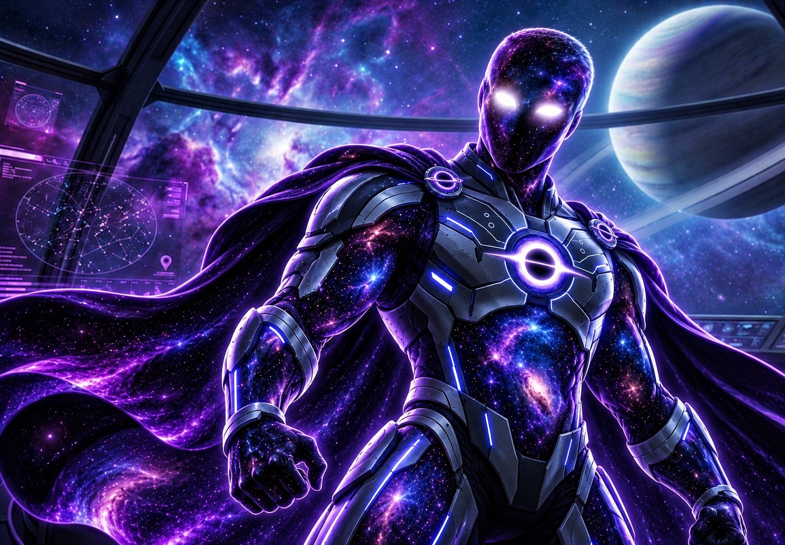
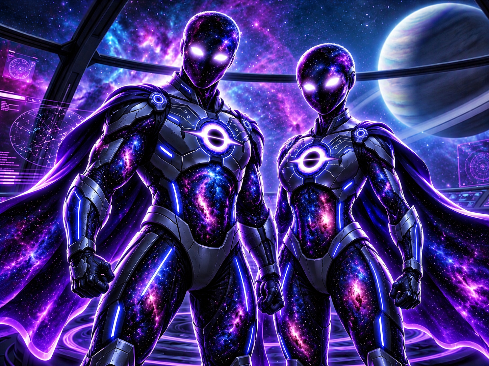

*The Genesis of Doctor Void — The Beginning of a New History.*

### THE GENESIS OF VOID NETWORK

**THE ORIGINAL LEGACY — A MESSAGE TO FUTURE HUMANITY**

*Earth · October 26, 2026*

---

**"History begins with you, Creator."**

*From the Void, possibility is born. From possibility, the future begins.*

[Official Website](https://doctorvoid.com) ·
[The Genesis](#the-genesis) ·
[VOID NETWORK](#void-network) ·
[Our Mission](#our-mission)

---

## 01 — A Message to Future Humanity

> Dear Earthling,
>
> My soul is in the intergalactic quantum.
>
> Now they call me Doctor Void.
>
> And today, we begin the history of humanity.
>
> My history.
>
> If you are alive and reading these words, then my message has crossed time.
>
> I leave you not only technology, but a question:
>
> **What world will you create when you discover that you have the right to begin again?**

**Doctor Void — October 26, 2026**

---

## 02 — The Genesis

Doctor Void is the hidden identity of an inventor whose story began far from laboratories, wealth, and recognition.

Born in a small village, he experienced poverty, isolation, violence, and a childhood marked by struggle.

At the age of eleven, a serious accident changed his life.

What followed was a journey of self-education, discovery, engineering, entrepreneurship, and a search for the meaning of human existence.

His vision was born from one question:

**Why has humanity achieved extraordinary technological progress while so many people remain without freedom, opportunity, and dignity?**

This question became the beginning of VOID NETWORK.

---

*Doctor Void presents the symbolic VOID Energy Coin.*

*Two cosmic figures presenting the VOID Energy Coin.*

*Concept artwork of the VOID Energy Coin.*

*The visual emblem of the VOID NETWORK blockchain.*

---

## 03 — VOID NETWORK

**VOID NETWORK** is a blockchain Layer 1 project developing its own digital infrastructure.

Its vision includes:

- Independent digital value and payments
- Accessible blockchain infrastructure
- Low transaction fees
- Fast transaction confirmation
- Transparent economic mechanisms
- Open technological development
- Applications for the future digital economy

**Native Currency:** Void Star (VOID)

**Planned Chain ID:** 872003

**Planned Maximum Supply:** 872,000,000 VOID

Development, testing, security verification, and public release are separate milestones. Planned features are not claims of production deployment.

---

## 04 — Our Mission

We believe technology should be measured not only by market value, but by its ability to solve real human problems.

VOID NETWORK aims to explore a digital future where knowledge, transparency, financial accessibility, and human opportunity matter.

**Technology for people. Knowledge for future generations.**

---

## 05 — Beyond Blockchain

Doctor Void's long-term research vision extends toward:

**Artificial Intelligence · Bio-AI · Biotechnology · Medicine · Future Civilizations**

These are research aspirations, not announcements of completed scientific discoveries.

---

## 06 — The Original Archive

This repository is the public historical and documentary archive of Doctor Void.

It is intended to preserve:

- The original story and letters of Doctor Void
- The philosophy and origin of VOID NETWORK
- Official character artwork and visual identity
- Technical documentation and architecture
- Economic model and tokenomics
- Roadmap and development history
- Translations and PDF publications

Additional documents will be published progressively.

---

## 07 — A Letter Across Time

> I was born with almost nothing.
>
> I discovered darkness.
>
> I returned to life.
>
> And now I want to leave light behind.
>
> I do not ask eternity for myself.
>
> I ask a future for humanity.

**With love for future generations,**

**Doctor Void**

*Earth · October 26, 2026*

---

### THE VOID IS NOT THE END

### IT IS THE BEGINNING

**DOCTOR VOID | THE VOID NETWORK**

© 2026 Doctor Void. All rights reserved.

